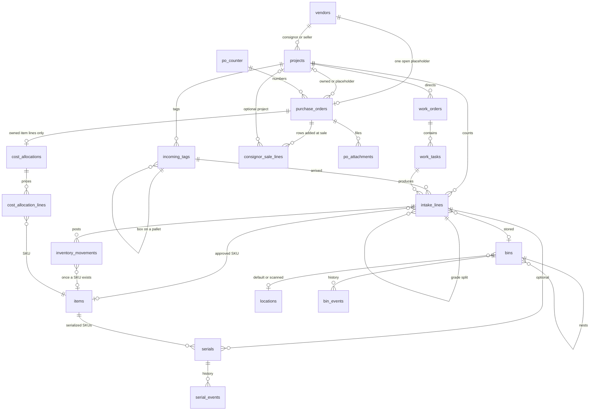
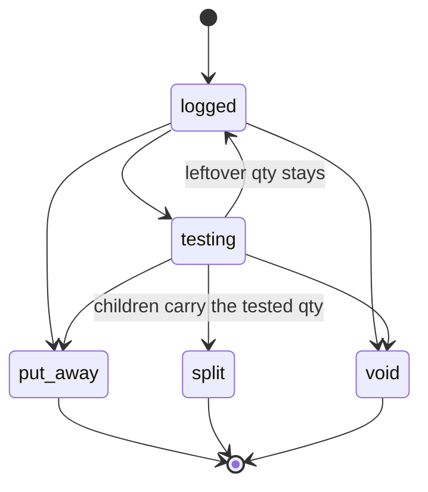
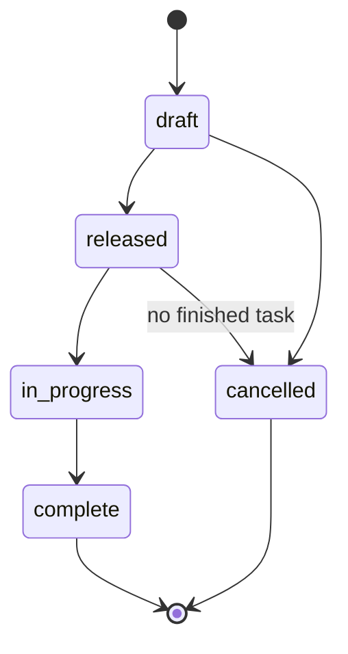
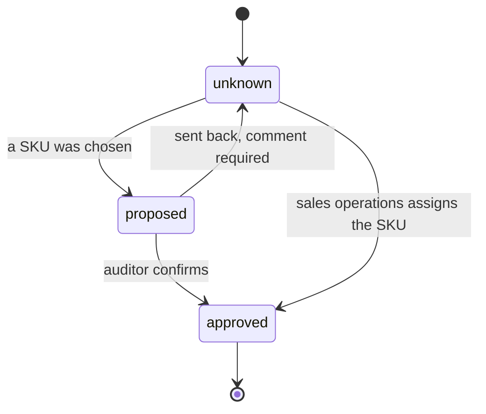
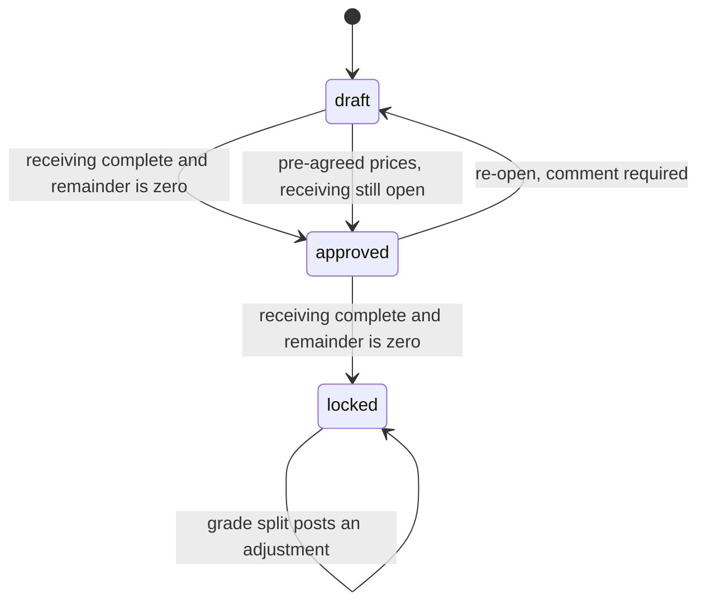

# Order to stock

Design only. Nothing in this note is built, and no migration is applied. Jan reviews it before any coding.

This is the inbound path from the truck to a bin of known SKUs. Purchase orders, the ledger, serials, and settlement math already sketched in `docs/purchase-orders.md` stay in force, except for cost. **Where that note prices a unit at intake or offers several automatic splits of a lot, this note wins:** COGS for owned goods is assigned only from the purchase order's item-lines total, and only on the final summary of received SKUs. Freight and other non-item costs stay outside that figure. A pricing officer types the unit prices. Consignment stays without a cost until a sale adds a row to that consignor's open placeholder purchase order.

Warehouse roles still see no money. New tables enable row level security and grant `service_role` only. The phone targets are Android Chrome and iOS Safari, with the scanner already described in `docs/mobile.md`.

## The seven situations

| | What arrives | What the floor does |
|---|---|---|
| 0 | A purchase order for a SKU that already exists | Receive the shipment and put it away. Rare. |
| 1 | A product that is not a SKU yet | Log what is printed on the part. Someone else creates the SKU. |
| 2 | Goods that need a test or a grade before the SKU is right | Test, then split the pile into the graded SKUs. |
| 3 | A server | Pull CPU, memory, SSD, HDD, and NIC/HBA cards into bins. |
| 4 | The server left on the pallet after that pull | One shell line, a server item, goes on a pallet bin (`-P`). Parts inside it are identified later by splitting that line. |
| 5 | Consignment on one or more projects (`AZSIM6930`, `OHNST6902`) | The same floor work as 1–4. When a unit sells, a row is added to that consignor's one open placeholder purchase order. The purchase price is the net sale times the consignor's share, after the sales manager enters the net. |
| 6 | Serial numbers | Usually captured on the SKUs that track them. Sometimes captured at intake, before the SKU is known. |

## What already exists

Items are one row per SKU. `items.quantity` is a cache. This design makes it the sum of ledger rows that already have a SKU. Bins today carry a five-digit reference and one suffix: `20000-P` is a pallet bin, `20014-B` a box bin, and a `C` suffix a crate bin. Those three suffixes are the only ones. They nest: a bin sits in another bin or at a location. `bin_events` stays the history. `current_location_id` is replaced by `parent_bin_id` and `location_id` as in `docs/purchase-orders.md`. Put-away uses the location codes under Bins and locations. It does not wait for a longer list.

`po_counter` issues the next purchase-order number. `po_attachments` holds the vendor PDF (invoice, quote, order confirmation, or other) in the private `po-documents` bucket. A role without `can_view_financials` receives neither the file nor a signed URL.

Roles follow `docs/roles.md`. The clerk receives, moves bins, and adds photos, and does not see money and does not create a SKU. Sales operations is an assignment in Users settings, the same kind of assignment as the pricing officer. It approves a proposed SKU, assigns one, and creates the missing item. The warehouse manager does not audit SKUs and does not create the item an intake line is waiting on. Where `docs/roles.md` gives `can_edit_items` to the warehouse manager, this note wins for those two actions. The pricing officer is described under Cost, and it lands in phase 1 of `docs/roles.md`. The sales manager is a separate assignment. Only that assignment may override whether one item is serialized, enter the net sales price on a consignor row, close that consignor's open placeholder, and post an adjustment after the purchase price is stored. See Serials and Consignment.

Every live write stores `operator_id` from the session and `occurred_at` plus `created_at` from the server clock. The phone shows the person's initials, taken from their name at that moment and stored on the event so a later rename does not rewrite history. Each step has a comment box with no short length limit.

## What happens on the floor

A truck arrives. Each pallet and each loose box gets an incoming tag, for example `INCOMING AZSIM6903 P001`. The tag is a label, not a SKU and not a bin number.

A work order tells the team what to pull. Parts land in a container. In this step a container is any of these: a coded bin, a box, a tote, a cart, or a pallet spot. It usually has a code, and that code can be scanned. A code is optional. What the record must have is the origin: where the pulled items came from. On the floor that origin is a post-it or a more formal note. It names the project, the incoming tag or pallet, the server type, and the units. Pallet X with 12 Type 1 servers and 8 Type 2 servers gets two containers. One origin is project `AZSIM6903`, tag `INCOMING AZSIM6903 P001`, Type 1 Server, 12 units. The other is the same pallet and Type 2 Server, 8 units. A photo or a scan of the note can be attached. If a container has no code, the system generates a temporary container ID and prints a 62 × 100 mm tag so the container can be scanned. Lineage uses the origin fields. It does not use the code.

An operator opens that container and logs the header, then the lines. The header is the container's origin: the project, the incoming pallet, the server type, and the quantity. Each line is a product identifier, a quantity, and the container that holds it. The operator may not know the SKU. A guessed SKU waits for audit. Sales operations can assign the SKU directly. If no SKU exists, sales operations creates one. A rejected guess goes back to unknown, and the comment is required. When the SKU is known, the screen suggests a bin on this same receiving that already holds it. The operator can accept that bin or choose another. The piles can share a bin, and each unit keeps its own origin.

Labels are one tap away on that screen: incoming tag, bin, item, and serial.

Some lines go to test. Probing and wiping happen there. Serials are captured on that bench when the SKU tracks them. The SKU can change from an untested identity to a graded one, and the bin can change with it. Fifty-one of item X in box B become 31 of grade A (SKU 1A in box B1) and 20 of grade B (SKU 1B in box B2).

The project ends as a list of SKUs, quantities, bins, and serials where the SKU has them. Each quantity can be walked back to the project, the incoming tag, the pallet, the server or container it came out of, and the person who logged it. That walk uses the container's origin fields, not its code.

The last physical step is put-away: the bin is placed at a location. The default for each suffix is a setting, seeded with `HWS.00.00.00` for a box (`-B`) or a crate (`-C`) and `HWR.00.00.00` for a pallet (`-P`). The operator can scan a more specific code. Put-away does not wait for another list. A serialized item cannot be put away until each piece has a serial.

## Domain model

A comment can hang on a project, tag, work order, task, intake line, serial, bin, or cost allocation. It is one table, not a line on the diagram.

### Projects

Same shape as `docs/purchase-orders.md`. A code such as `AZSIM6930` is the name the floor already uses. `type` is `consignment`, `owned_lot`, or `takeout`. `basis` is `consigned` or `owned`. Consignment is always consigned. An owned lot is always owned.

| Column | Notes |
|---|---|
| `id` | uuid |
| `code` | unique, `AZSIM6930` |
| `name` | text |
| `type` | `consignment`, `owned_lot`, or `takeout` |
| `basis` | `consigned` or `owned` |
| `vendor_id` | consignor or seller. On a consignment project this is the consignor a later sale pays |
| `physical_status` | `received`, `processing`, `processed` |
| `financial_status` | `open`, `cost_pending`, `costed`, `settling`, `settled` |
| `status` | `active` or `closed` |
| `model` | `revenue_share` or `negotiated` on consignment. Empty when owned |
| `consignor_share_percent` | the project's own general split, copied from the consignor when the project is created. A number from 0 to 100. A 75/25 split is stored as 75 and shown as 75/25. Money. Hidden from the floor. An item never has its own split |
| `settlement_cadence` | `per_sale`, `periodic`, or `negotiated_batch` |
| `notes` | text |
| `operator_id`, `operator_initials`, `occurred_at`, `created_at` | session, initials snapshot, server clock |

`vendors` gains `is_consignor` and `consignor_share_percent`. A consignment project requires a vendor with that flag. `consignor_share_percent` is that consignor's general split, a number from 0 to 100. A 75/25 consignor/consignee split is stored as 75 and shown as 75/25. The consignee's figure on screen is 100 minus the stored share.

Optional rows in `consignor_taxonomy_splits` name a different split for one taxonomy: `vendor_id`, `taxonomy_id`, and `consignor_share_percent`. One row per consignor and taxonomy. An SSD row stored as 60 is the extra data-destruction case, shown as 60/40.

Creating a consignment project copies the consignor's general split onto `projects.consignor_share_percent` and copies each taxonomy row into `project_taxonomy_splits` (`project_id`, `taxonomy_id`, `consignor_share_percent`). After that copy, the project's own settings are the ones a sale on the project uses. The project can change its general split, for example from 75 to 50, and it can add or change a taxonomy split, for example NIC cards stored as 0 and shown as 0/100. A later edit to the consignor does not change the project's copy. An untouched copied SSD row stays 60 after the project's general split becomes 50.

An item never carries a share. An item may be excluded from consignment, and then it is not a consignment item. Warehouse screens show the code, the type, the consignor's name, and counts. Share percent and every dollar stay off those payloads.

### Purchase orders and the counter

The purchase order tables already exist. Owned receipts and the pricing officer's allocation use them as they are.

`po_counter` is one row. It hands out the next number. A consignor placeholder purchase order uses that same counter when the first sale opens it. The floor never sees the counter.

`po_attachments` is the file on the order: `vendor_invoice`, `quote`, `order_confirmation`, or `other`. Bytes live in `po-documents`. Signed URLs exist only for `can_view_financials`.

Columns this flow reads from `purchase_orders`: `id`, `number`, `vendor_id`, `project_id`, `purpose` (`purchase`, `settlement`, `buyout`, or `consignor_placeholder`), `status`, `currency`, `freight_in`, `pre_agreed_prices`, the item-lines total, and the grand total finance already sees (item lines plus freight-in and any tax). Vendor line prices are not COGS. Owned COGS is the allocation of the item-lines total. Consignment COGS is the purchase price on a placeholder row. See Cost.

`pre_agreed_prices` is off by default. It is set only when the vendor agreement already names a unit price for individual components. With the flag off, the pricing officer cannot approve until receiving is complete. With the flag on, the officer can enter and approve those unit prices before the last receipt. See Cost.

A placeholder purchase order has its own lifecycle, `placeholder_status`: `open`, `closed`, then `paid`. It does not use the receiving statuses. At most one row per vendor has `purpose = consignor_placeholder` and `placeholder_status = open`. The sales manager closes it by hand. See Consignment.

### Consignor sale rows

One row is one sale of consigned goods, added to the consignor's open placeholder purchase order. Money columns are visible only with `can_view_financials`. Row level security is on. `service_role` is the only grant.

| Column | Notes |
|---|---|
| `id` | uuid |
| `purchase_order_id` | the consignor's placeholder purchase order |
| `sales_order_line_id` | the sale it came from. Unique, so the same sale cannot be added twice. The sales-order table arrives with sales. The unique constraint is part of this design |
| `item_id` | the SKU sold, when the sale has one |
| `description` | item description |
| `qty` | quantity sold, greater than 0 |
| `project_id` | optional. `AZSIM6930` or `OHNST6902` when the lineage has a project |
| `intake_line_id` | the pile the sold unit came from, when lineage has one |
| `net_sales_price` | money, empty until the sales manager types it. ITS does not compute fees or shipping. Empty means the row is pending |
| `consignor_share_percent` | the resolved consignor share, snapshotted when the row is created. A number from 0 to 100. A 75/25 split is stored as 75. Later rate changes do not rewrite it. Not typed on the row |
| `purchase_price` | empty until the net is entered. Then `net_sales_price × consignor_share_percent / 100`, rounded half-up to the cent. A $100.00 net at 75 is $75.00. A share of 0 is $0.00, and that price is valid. Not typed |
| `priced_at` | when the purchase price was stored. The row locks at that moment |
| `operator_id`, `operator_initials`, `occurred_at`, `created_at` | the sale posting, from the session and the server clock |

A sale that names a project uses that project's settings. If `project_taxonomy_splits` has a row for the item's taxonomy, that percent is the share. Otherwise the project's general `consignor_share_percent` is the share. A sale with no project uses the consignor the same way: the consignor's taxonomy split when one exists, otherwise the consignor's general split. The row stores that percent in `consignor_share_percent`. A later change to the consignor or the project does not rewrite the row.

An item with `consignment_excluded` set is not a consignment item. A sale of it does not add a placeholder row. The flag is not a percentage.

Before `priced_at`, the sales manager may edit the row, including a return or a correction. Each edit writes an audit row: who, when, the old values, the new values, and a comment. After `priced_at` the row is locked. A later return or correction is an adjustment, the same pattern as a grade split after a locked allocation. The locked row stays. The adjustment stores a reason, a comment, the initials, and the time, and any corrected net. Its purchase price is still that net times the snapshotted share, divided by 100, rounded half-up to the cent. A share of 0 stays $0.00. Nobody types the purchase price.

### Incoming tags

The paper on the pallet or the box before anyone knows the SKUs. It is a pallet tag, printed on the 62 × 100 mm DK-1202 roll, the same stock as the serial label. The page is landscape. The printable width inside the padding is 94 mm, the same convention as `docs/labels.md`. The print path is the serial-label pipeline.

The large line is the tag ID, for example `INCOMING AZSIM6903 P001`. A Code 128 barcode encodes that same ID. Under it: the project, the pallet or box number, the received date, and the operator's initials.

| Column | Notes |
|---|---|
| `id` | uuid |
| `project_id` | required |
| `purchase_order_id` | set when the truck is a known purchase order with no project |
| `kind` | `pallet` or `box` |
| `sequence` | `P001`, `B002`, unique inside the project |
| `label` | the tag ID, unique. Printed large and encoded in the Code 128 barcode. Example: `INCOMING AZSIM6903 P001` |
| `parent_tag_id` | a box tag can name its pallet tag |
| `bin_id` | set when this physical object is also a bin, or when the goods have moved into one |
| `notes` | text |
| `operator_id`, `operator_initials`, `occurred_at`, `created_at` | as everywhere |

### Work orders and tasks

A work order is the instruction. Tasks are the pulls.

| Column | Notes |
|---|---|
| `id` | uuid |
| `project_id` | required |
| `incoming_tag_id` | the pallet or box the work starts from |
| `title` | `Pull Pallet X` |
| `state` | see the work-order states |
| `instructions` | text, the long comment to the crew |
| `operator_id`, `operator_initials`, `occurred_at`, `created_at` | who released it |

`work_tasks`:

| Column | Notes |
|---|---|
| `id` | uuid |
| `work_order_id` | required |
| `server_type` | `Type 1`, `Type 2`, free text until a catalog exists |
| `server_qty` | the count on the clerk's tag, 12 or 8 |
| `bin_id` | the container that receives the pull. Its origin is this task's project, incoming tag, server type, and quantity |
| `instructions` | text |
| `state` | `open`, `done`, or `cancelled` |
| `operator_id`, `operator_initials`, `occurred_at`, `created_at` | who finished the task |

### Intake lines

One line is one product pile: an identifier, a quantity, a bin, and eventually a SKU.

| Column | Notes |
|---|---|
| `id` | uuid |
| `project_id` | set on project work. Empty on a plain purchase-order receipt |
| `consignor_vendor_id` | copied from the project when the goods are consigned. A later change to the project does not rewrite it |
| `purchase_order_id`, `po_line_id` | the purchase order these goods came in on. Required for anything that will be costed from a purchase order. A grade-split child copies it from the parent. Empty on consignment that has no purchase order |
| `incoming_tag_id` | the pallet or box tag |
| `work_task_id` | set when a pull produced the line |
| `parent_line_id` | the line this one was split from. Empty on the first count |
| `source_bin_id` | the pallet bin (`-P`) a pulled part came off. A chassis is a server item, never a bin, so this column does not point at one |
| `line_kind` | `whole`, `pulled`, or `remains`. `remains` is the one shell line for a server item left on the pallet |
| `identifier` | what the operator typed or scanned: part, model, or a description |
| `qty` | greater than 0 |
| `bin_id` | the container this pile sits in. Lineage reads that container's origin, not its code |
| `item_id` | empty until the SKU is approved |
| `proposed_item_id` | the guess waiting for audit |
| `sku_state` | `unknown`, `proposed`, or `approved` |
| `line_state` | `logged`, `testing`, `split`, `put_away`, or `void` |
| `grade` | text, when grading has happened |
| `notes` | text |
| `operator_id`, `operator_initials`, `occurred_at`, `created_at` | who logged it |

`line_kind = remains` is one shell line: the server item left after the pull. It sits on a pallet bin (`-P`). It is not a bin, and it is not a second pull into a parts bin. One line covers that shell until someone identifies the parts still in it. That identification splits the line. The shell moves to `split`. Each part is a new intake line with `parent_line_id` pointing at the shell, and each child copies the shell's project, incoming tag, and purchase order.

A known purchase-order line starts with `sku_state = approved` and `item_id` already set. The identifier is the SKU.

### SKU audit

The audit is the line's `sku_state`, plus one event row per change.

| Column | Notes |
|---|---|
| `id` | uuid |
| `intake_line_id` | required |
| `from_state`, `to_state` | `unknown`, `proposed`, `approved` |
| `item_id` | the SKU this event names |
| `comment` | text. Required when a proposal is rejected |
| `operator_id`, `operator_initials`, `occurred_at`, `created_at` | sales operations, or the clerk who proposed |

A clerk may set `proposed`. Sales operations approves it, assigns a different SKU, or creates the item. Creating an item uses the existing save, which assigns the SKU number. The clerk cannot open that form. The warehouse manager cannot approve, assign, or create. Rejecting a proposal sets `sku_state` back to `unknown` and requires a comment. The line does not stay `proposed`.

### Grade operations

The 51-to-31/20 split is one operation. The parent line moves to `split`. Each result is a new intake line with `parent_line_id` pointing at the parent.

| Column | Notes |
|---|---|
| `id` | uuid |
| `parent_line_id` | the pile that was tested |
| `qty_in` | how many were tested, 51 |
| `comment` | text |
| `operator_id`, `operator_initials`, `occurred_at`, `created_at` | the bench |

Child lines store the new SKU, the new bin, the grade, and the quantity. Their quantities add up to `qty_in`. A remainder that was not tested stays on the original SKU. The parent stays `logged` or `testing` for that leftover quantity. The tested portion is the parent of the children. The remainder can move to a different bin. That move is an ordinary `out` and `in` with one `transfer_id`. The parent line keeps its origin, so the move does not start a new lineage.

### Serials

Same shape as `docs/purchase-orders.md`. A serial may exist before the SKU: `item_id` is empty and the serial points at the intake line.

`taxonomies.serialized` is the default for items in that taxonomy. It is yes for the types that are usually one serial per piece: HDD, SSD, high-end CPUs, and cards. It is no for the rest.

`items.serialized` is the item's own setting. Empty means use the taxonomy. The value on the item, after that fallback, is what receiving and put-away use. The sales manager is an assignment in Users settings. Only that assignment may set `items.serialized` to yes or no against the taxonomy default. The override is stored on the item. A later change to the taxonomy does not rewrite an item that already has its own value.

Put-away is refused when the item is serialized and the line has fewer captured serials than its quantity. The block is the count, not a warning. An item that is not serialized can be put away with no serials.

| Column | Notes |
|---|---|
| `id` | uuid |
| `serial` | trimmed, unique among rows still `in_stock` |
| `item_id` | empty until the SKU is approved |
| `intake_line_id` | the pile it was captured on |
| `project_id` | copied from the line |
| `ownership` | `owned` or `consigned` |
| `status` | `in_stock`, `sold`, `rma_returned`, `returned_to_vendor` |
| `stock_status` | `available`, `damaged`, `quarantine`, `hold` |
| `operator_id`, `operator_initials`, `occurred_at`, `created_at` | who captured it |

`serial_events`: `serial_id`, the new status, `movement_id` when a ledger row exists, `ref_type`, `ref_id`, `ref_label`, `operator_id`, `operator_initials`, `occurred_at`, `created_at`.

### Bins and locations

Keep `bins` and `bin_events`. Add the nesting columns from `docs/purchase-orders.md`. In the pull and work-order step, a bin is any container: a coded bin, a box, a tote, a cart, or a pallet spot. The same table holds both the counter-issued warehouse bins and these containers.

A bin issued from the bin counter still has a required `reference` and a `type` of `B`, `C`, or `P`. The reference is five digits, a hyphen, and that letter: `20014-B` is a box bin, a `C` suffix is a crate bin, and `20000-P` is a pallet bin. No other suffix is valid. The reference matches `^\d{5}-[BCP]$`. Those labels stay the 90 mm × 29 mm labels in `docs/bin-labels.md`. The counter is not used when a pull container has no code, and a temporary id is not a warehouse reference.

A warehouse bin is one row per physical code. `reference` is unique and is the label. That row holds the code and the bin's current location. It does not hold the origin of the goods. Each use of the bin is a bin cycle. The cycle stores the origin description, the project, and the incoming tag. Intake lines and ledger rows point at the cycle. A cycle opens on the first receive into an empty bin and closes when the quantity in that cycle reaches 0. The next receive opens a new cycle on the same bin row. The earlier cycle keeps the origin it was logged with. Scanning a code finds the bin, and the open cycle when the bin still holds stock. The history view lists every cycle, the open one first. A reused code is a new cycle, not a new bin row.

| Column | Notes |
|---|---|
| `id` | uuid. This is the lineage key |
| `bin_id` | the physical bin. One open cycle per bin |
| `status` | `open` or `closed`. `closed_at` is set when the quantity reaches 0 |
| `origin_description`, `project`, `incoming_tag` | copied onto the cycle when it opens, then left as they are |
| `default_location_id` | the put-away setting for that suffix at the moment the cycle opened |
| `opened_location_id` | where the bin was when the cycle opened |
| `opened_at`, `closed_at`, `opened_by_initials` | who opened it |

| Column | Notes |
|---|---|
| `id` | uuid |
| `container_kind` | `bin`, `box`, `tote`, `cart`, or `pallet_spot`. Existing warehouse bins are `bin` |
| `number`, `type`, `reference` | the counter-issued warehouse code when this row is one of those bins. `type` is `B` box, `C` crate, or `P` pallet. `reference` matches `^\d{5}-[BCP]$` and stays unique |
| `code` | optional. The mark on the physical container, scanned when it is present. Not unique, and not the lineage key. A counter-issued bin copies its `reference` here |
| `coded_bin_id` | set when `code` is an existing warehouse bin. Points at that bin. The lineage key is the cycle on that bin, not a second bin row |
| `temporary_id` | set only when `code` is empty. Unique. A generated scan target. Not taken from `bin_counter`. Not used for lineage |
| `origin_description` | required on a pull container. The post-it or the formal note, in words |
| `origin_project_id` | the project the pull came from |
| `origin_incoming_tag_id` | the incoming pallet or box |
| `origin_server_type` | `Type 1`, free text, copied from the task |
| `origin_qty` | the units on that note, 12 or 8 |
| `origin_file_path` | optional. A document or a photo of the note |
| `origin_file_kind` | `document` or `photo`. Empty when there is no file |
| `parent_bin_id`, `location_id` | nesting. At most one is set |
| `notes`, `printed_count`, `last_printed_at`, `created_at`, `created_by` | unchanged |

The file lives in the private `bin-documents` bucket. It is a warehouse note, not a vendor bill, so `can_view_financials` is not required to read it. A clerk with `can_add_photos` can attach it. Row level security is on. `service_role` is the only grant.

Lineage reads `origin_project_id`, `origin_incoming_tag_id`, `origin_server_type`, and `origin_qty`. Assigning a code later does not change those fields. On a coded warehouse bin, the cycle holds the origin, the project, and the incoming tag, and that cycle is what later rows point at.

A pull container must have a `code` or a `temporary_id`, so it can be scanned. When the temporary id is created, the work-order screen prints one 62 × 100 mm tag on the DK-1202 roll, through the serial-label pipeline: landscape, 94 mm printable width. The large line and the Code 128 are the temporary id. Under them: the project, the incoming tag, the server type, the units, and the initials.

`bin_events` keeps `created`, `printed`, `reprinted`, and `moved`. A move gains `operator_id`, `operator_initials`, `occurred_at`, `from_parent_bin_id`, and `to_parent_bin_id`.

`locations` holds the places a bin can be put away to. A location type is a name, a prefix, and a pattern. Shelves and racking are seeded. An admin can add another type, and then add codes that match it. This note does not invent an office-lab code.

`location_types` columns:

| Column | Notes |
|---|---|
| `id` | uuid |
| `slug` | stable key. `shelves` and `racking` are seeded |
| `name` | Henderson Warehouse Shelves, Henderson Warehouse Racking, or a name an admin adds |
| `prefix` | capitals. `HWS`, `HWR`, or a prefix an admin adds |
| `pattern` | the code must match. Anchored, and it includes the prefix |

The two seeded places are rows in `locations`. Put-away can use them immediately. The default for each bin suffix is a setting that points at one of those rows. It is seeded `HWS.00.00.00` for `-B` and `-C`, and `HWR.00.00.00` for `-P`. An admin changes it on Settings by picking a location that already exists. The new value is used when a bin is created and is recorded on a cycle when that cycle opens. Bins and cycles that already exist keep the location they were given.

| Column | Notes |
|---|---|
| `id` | uuid |
| `code` | unique. `HWS.00.00.00` or `HWR.01.04.06.N` |
| `location_type_id` | shelves, racking, or a type an admin added |
| `row` | the row segment, parsed from the code |
| `bay` | the bay segment |
| `elevation` | the elevation segment, in feet |
| `orientation` | racking only. `N`, `S`, `E`, `W`, or `C` (centre). Empty on shelves, and empty on the default `HWR.00.00.00`. A real pallet slot has one |
| `description` | text. Henderson Warehouse Shelves, or Henderson Warehouse Racking |

`HWS.Row.Bay.Elevation` is Henderson Warehouse Shelves, then the row, the bay, and the elevation in feet. `HWR.Row.Bay.Elevation.Orientation` is Henderson Warehouse Racking, then the row, the bay, the elevation in feet, and an orientation. Row, bay, and elevation are always two digits.

Orientation is for racking only. A shelves code never has one. `HWR.00.00.00` is the default and has no position. A real pallet slot has one letter: `N`, `S`, `E`, `W`, or `C` for centre.

A bay is typically 98 inches wide. A 42 inch pallet takes two positions on one bay elevation, `N`/`S` or `E`/`W`. A 32 inch Euro pallet takes three, `N`/`C`/`S` or `E`/`C`/`W`. That is the capacity of a bay elevation: two positions or three, depending on the pallet.

The check is one regex per kind.

| Kind | Pattern |
|---|---|
| Shelves | `^HWS\.\d{2}\.\d{2}\.\d{2}$` |
| Racking | `^HWR\.\d{2}\.\d{2}\.\d{2}(\.[NSEWC])?$` |
| Bin reference | `^\d{5}-[BCP]$` |

The two defaults pass: `HWS.00.00.00` and `HWR.00.00.00`.

A scanned code is accepted when it matches exactly one location type and starts with that type's prefix. Shelves and racking still store row, bay, elevation, and orientation. Another type stores the code and the type. The operator can scan a code that passes that check. Put-away writes the bin's current location and does not wait for a locator list to be loaded first.

### Bin consolidation

During receiving, identical SKUs should share a bin. When a line has an item, the screen looks for a bin already holding that SKU on the same receiving. The receiving is the project, or the incoming tag, or the purchase order when the receipt has no project. The screen suggests that bin. An empty bin is not suggested. The operator accepts a suggestion or chooses another bin, including an empty one, by scanning it.

Accepting the suggestion sets this line's bin. It does not delete the other line or rewrite its origin. Each unit still walks back through its own intake line, tag, project, and purchase order. A later move of an untested remainder uses the same ledger move and leaves that origin in place.

### Ledger

`inventory_movements` is the only quantity log. `items.quantity` is rewritten, in the same transaction, to the sum of movements that have an `item_id`. Quantity with no SKU stays on the movement and on the project, and stays out of `items.quantity`.

| Column | Notes |
|---|---|
| `id` | uuid |
| `item_id` | empty while the SKU is unknown |
| `project_id` | set for project goods, and kept after a settlement purchase order exists |
| `intake_line_id` | the pile |
| `bin_id` | empty only while a known receipt has not been put in a bin |
| `direction` | `in` or `out` |
| `qty` | greater than 0 |
| `ownership` | `owned` or `consigned` |
| `stock_status` | `available`, `damaged`, `quarantine`, `hold` |
| `transfer_id` | shared by the two rows of a bin-to-bin move or a status change |
| `ref_type` | `purchase_receipt`, `project`, `putaway`, `grade_split`, `status_change` |
| `ref_id`, `ref_label` | the purchase order, project, or tag |
| `source_movement_id` | the layer an `out` consumed |
| `operator_id`, `operator_initials`, `occurred_at`, `created_at` | server |
| `notes` | text |

Putting a quantity into a different bin is an `out` and an `in` with one `transfer_id`. Moving the bin itself, later, is only a `bin_events` row. The product rows keep their `bin_id`.

A grade split posts an `out` of the parent and an `in` of each child. When the parent had a SKU, that SKU's quantity falls and the children's SKUs rise. There is no second receipt.

Cost is not a column on this table.

### Comments

| Column | Notes |
|---|---|
| `id` | uuid |
| `entity_type` | `project`, `incoming_tag`, `work_order`, `work_task`, `intake_line`, `serial`, `bin`, `cost_allocation`, `consignor_sale_line` |
| `entity_id` | uuid of that row |
| `body` | text, no short limit |
| `operator_id`, `operator_initials`, `occurred_at`, `created_at` | who wrote it |

### Cost allocations

One allocation prices one non-consignment purchase order. It prices the final summary, which is SKU and quantity after every split. It does not price intake lines.

| Column | Notes |
|---|---|
| `id` | uuid |
| `purchase_order_id` | required. Consignment orders are refused |
| `project_id` | copied when the order has a project |
| `state` | `draft`, `approved`, or `locked` |
| `item_lines_total` | the merchandise total snapshotted when the row is approved or locked. Freight, shipping, tax, and other non-item costs are excluded |
| `remainder` | `item_lines_total` minus the sum of line extensions. Lock requires this to be zero once receiving is complete |
| `variance_note` | set when a pre-agreed approval is still open and the running extensions do not yet equal the item-lines total |
| `summary_changed_at` | set when a grade split or a correction changes the received list after approval |
| `operator_id`, `operator_initials`, `occurred_at`, `created_at` | the pricing officer |
| `notes` | text. Required on re-open and on an adjustment |

`cost_allocation_lines`:

| Column | Notes |
|---|---|
| `id` | uuid |
| `allocation_id` | required |
| `item_id` | the received SKU. Required |
| `qty` | quantity of that SKU traced to this purchase order. It updates as receipts land, until the allocation is locked |
| `unit_price` | numeric(12,4), zero or greater. What the officer typed |
| `extension` | numeric(12,2). The dollars posted for the line |
| `rounding_note` | required when the extension is not the cent rounding of price times quantity |
| `source` | `summary` or `adjustment` |
| `supersedes_line_id` | the earlier line this one replaces |
| `operator_id`, `operator_initials`, `occurred_at`, `created_at` | who priced it |

Approving posts buy transactions for the extensions of the quantity received so far (`source = po`). It does not post another inventory `in`. A later receipt on a pre-agreed order updates those buys when the officer locks, or when they approve again. Warehouse payloads omit the allocation, the buy, and the remainder.

## Walkthroughs

### 0. A purchase order for a known SKU

A purchase order already lists the SKU and the quantity. The clerk scans the PO and confirms the count. If this purchase order already has that SKU in a bin, the screen suggests that bin. The clerk accepts it or scans another, and prints the bin label if the bin is new. The line is born approved. The ledger `in` uses that SKU. `items.quantity` updates. No project is required. Sharing the suggested bin does not merge this line into the earlier one.

The pricing officer later opens the summary of SKUs and quantities actually received. They type a unit price. The screen may start from the vendor's line price. That price becomes COGS only when the allocation is approved. By default Approve waits until receiving is complete, and the extensions must equal the item-lines total. A purchase order flagged `pre_agreed_prices` can be priced earlier. See Cost.

### 1. The product is not a SKU yet

The operator scans the incoming tag, types the part number from the label, enters the quantity, and scans the bin. `sku_state` stays `unknown`. The quantity is on the ledger with an empty `item_id`, so the items list does not grow.

Search suggestions use the same part, OEM, and model matches as Lens. The screen lists them and does not pick one. A person who recognizes a SKU sets it to `proposed`. Sales operations approves it, or assigns a different one, which is already `approved`. If none of the suggestions is right, sales operations creates the item. The SKU number is assigned on save, as it is today. One transaction then writes `item_id` onto the line, its serials, and its ledger rows, and refreshes `items.quantity`. There is no second `in`. Rejecting the proposal returns the line to `unknown` and requires a comment. Once the SKU is known, the screen suggests a bin on this receiving that already holds it. The operator can accept that bin or leave the line where it is.

### 2. Test and grade, including 51 to 31 and 20

Item X, still untested, sits in box B, quantity 51. The bench scans box B, records a test comment, and captures serials for the pieces that have them.

The result is one grade operation. Thirty-one move to SKU 1A in box B1. Twenty move to SKU 1B in box B2. The parent line becomes `split`. Each child stores `parent_line_id`, the new bin, the grade, and the operator. The ledger takes 51 out of item X and puts 31 and 20 in. Box B's balance for item X is zero. Serials that were on the parent follow the child they were graded into, and `serial_events` records the move.

If the SKUs 1A and 1B are new, sales operations creates them and approves them before the split is posted. If they already exist, sales operations approves the choice on the bench.

A test that covers only part of the 51 leaves the rest on item X. That remainder can move to another bin. The move is the ordinary ledger pair, and the parent line still carries the origin.

### 3. Pulling a server apart

Pallet X is tag `INCOMING AZSIM6903 P001` and holds 12 Type 1 servers and 8 Type 2 servers. The work order `Pull Pallet X` has two tasks. Each task opens a container and records the origin: project `AZSIM6903`, that incoming tag, the server type, and 12 or 8 units. A container that already has a code is scanned. A container with no code gets a temporary id and a 62 × 100 mm tag. The origin note can be photographed or attached.

The operator scans the pallet tag, confirms the server type and the 12, then adds lines: a CPU identifier and a quantity, memory, SSDs, HDDs, NIC and HBA cards. Each line has its own container, which may be the task container or a smaller box inside it. `line_kind` is `pulled`. `source_bin_id` is the pallet bin (`-P`) the server was sitting on. The chassis is a server item, not that bin. Identifiers that are not SKUs follow situation 1.

### 4. The shell left on the pallet

After the pull, each server still on the pallet is one intake line. `line_kind` is `remains`. The line is a server item, the shell, and it is placed on a pallet bin (`-P`). It goes through the same unknown, proposed, and approved SKU path. The motherboard, heatsinks, PSUs, risers, and cables are not separate lines yet.

When someone identifies those parts, the shell line splits. The shell moves to `split`. Each part line points at the shell with `parent_line_id` and keeps the shell's project, incoming tag, and purchase order. A comment on the shell says what was found. The parts do not have to be logged as their own lines at the pull.

### 5. Consignment

`AZSIM6930` and `OHNST6902` are projects with `basis = consigned`. Each points at a vendor with `is_consignor` set. Intake copies that vendor onto `consignor_vendor_id`. Situations 1 through 4 are unchanged. The ledger rows are `consigned`. No cost allocation can be created. The pricing officer's list does not offer these projects. Intake has no cost.

When an item that came from consignor X sells, the sale is walked back to X: serial or bin, intake line, project, consignor. One purchase row is added to that consignor's open placeholder purchase order.

| On the row | Meaning |
|---|---|
| Item description | The sold item |
| Qty sold | How many this sale took |
| Net sales price | Typed by the sales manager. The fees and shipping behind that number are outside ITS. The row can be saved before this is known |
| Consignor share | Snapshotted onto the row as a number from 0 to 100, shown as consignor/consignee. With a project: that project's taxonomy split, or its general split when the taxonomy has none. With no project: the consignor's taxonomy split, or the consignor's general split. A 75/25 split is stored as 75. Not a per-item rate |
| Purchase price | Computed once the net is entered: net times the snapshotted share, divided by 100, half-up to the cent. $100.00 at 75 is $75.00. A 0/100 split is $0.00, and that is valid. Not typed |
| Project | Optional, such as `AZSIM6930` or `OHNST6902` |

The row stores `sales_order_line_id`, and that value is unique, so the same sale cannot be added twice. The share is copied onto the row when the row is created. A later change to the consignor or to the project does not rewrite it. The purchase price stays empty until the sales manager enters the net. There is no manual override of that price. A stored share of 0 produces a purchase price of $0.00.

An item marked excluded is skipped. No row is added, because that item is not on consignment.

The next sale from the same consignor adds another row to that same open purchase order, until the order is closed. If the consignor has no open placeholder, one is opened automatically, `po_counter` issues the number, and the sale row is added to it. A second open placeholder for the same consignor is refused.

The sales manager closes the open placeholder. The close follows a conversation with the consignor. It is often about a month, and a large or a small dollar volume can make it sooner or later. Nothing closes it on a schedule. The screen can show the age of the open order and the running total of its purchase prices, so the close is prompted and still manual. Closed does not accept new rows. Paid records that the consignor was paid.

COGS for that unit is the purchase price on its row, recognized when the net is entered and the price is stored. That matches the rule that consignment has no cost at intake. A pending row has no COGS yet.

Until that price is stored, a return or a correction is an edit of the row. Each edit records who, when, the old values, the new values, and a comment. Once the price is stored, the row is locked. A later return or correction is an adjustment. The locked figures stay. The adjustment carries the reason, the comment, the initials, and the time. A corrected net still multiplies by the snapshotted share, divides by 100, and rounds half-up to the cent.

Net sales price, the share, and the purchase price are money. Only `can_view_financials` receives them. The placeholder order and `consignor_sale_lines` follow the same rule as the other new tables: row level security on, `service_role` only.

### 6. Serials at SKU level, and sometimes at intake

HDD, SSD, high-end CPU, and card taxonomies default to serialized. A sales manager can override that on one item. Put-away reads the item setting, and it is refused until every piece on a serialized line has a serial. The bench is the usual place to capture them, because that is when the drive or the board is in hand. The serial screen is the one already used for serial labels: scan or type, Enter adds, duplicates are ignored.

Some piles are serialized before anyone knows the SKU. The operator adds the serial on the intake line. `item_id` is empty. When the SKU is approved, the same serial row gains `item_id`. A second in-stock copy of the same serial is refused anywhere in the company.

## State machines

### Intake line

`split` and `void` stop that line. Children of a split start again at `logged`. Put-away means the bin has a location. A new bin is placed at the default setting for its suffix, seeded `HWS.00.00.00` or `HWR.00.00.00`, unless the operator scanned a specific code. When the SKU is serialized, put-away is refused until the serial count matches the quantity. A line can sit in a holding bin from the moment it is logged.

### Work order

A task is `open`, then `done` or `cancelled`. The order becomes `in_progress` when the first task is done, and `complete` when every task is done or cancelled and at least one is done.

### SKU approval

A grade split does not move an approved parent backwards. The children have their own SKU state. Sales operations can assign from `unknown` straight to `approved`. A rejection is the edge back to `unknown`, and it requires a comment.

### Cost allocation

Without `pre_agreed_prices`, Approve waits until receiving is complete and the remainder is zero. With the flag, Approve can happen earlier. Lock still waits until receiving is complete and the extensions equal that purchase order's item-lines total. A locked row stays locked while an adjustment is added beside it.

## Lineage

Every intake line stores the incoming tag, the project, the purchase order it came in on, the work task, the source bin, and the parent line.

From any bin quantity or any serial, the walk is:

1. The ledger row or the serial points at an intake line.
2. That line's `parent_line_id` chain ends at the first count, which still has the incoming tag, the project, and `purchase_order_id`. A split child copies that purchase order, so the quantity still belongs to one order.
3. The tag names the pallet. A box tag names its pallet tag.
4. The work task names the server type. `source_bin_id` is the pallet bin the part came off. The shell line is the server item left on that pallet. A part identified later points at that shell through `parent_line_id`.
5. On consignment, the intake line's `consignor_vendor_id` is the vendor who receives the placeholder purchase-order row. It was copied from the project and is not rewritten if the project later points at someone else.
6. Each line, tag, task, serial event, sale row, and comment has the operator's initials and the server time.

The project screen lists SKU, quantity, bin, and serials, and each row opens this walk. A quantity that has been split shows the children, and each child shows the parent pile and the grade operation. Nothing in the walk is deleted when a line is split or voided. Void keeps the row and the events.

Moving a bin to a location does not break the walk. The product still points at the bin. The bin points at the location.

## Cost

### Who gets a cost, and when

COGS for owned goods is assigned per purchase order, and only for items. A project with several purchase orders gets one allocation each. There is no project-level pool. Each allocation uses that order's item-lines total and only the SKUs whose intake lines name that order.

The item-lines total is the sum of the merchandise lines. Freight, shipping, tax, and any other landed or non-item cost stay outside it. The grand total on the purchase order can be higher. The allocation does not have to equal that grand total.

Consignment stays without a cost from intake through put-away. At sale, COGS is the purchase price on that unit's row on the consignor's placeholder purchase order. That price is the net the sales manager typed, times the consignor share snapshotted on the row, divided by 100, and rounded half-up to the cent. A share of 0 is a purchase price of $0.00. The price is empty until the net is entered. It is not this allocation, and it is not typed by hand.

For an owned purchase order, the summary is one row per SKU: the quantity whose intake line, after every split, still carries that `purchase_order_id`. Two bins of the same SKU on the same order are one row. A SKU that also arrived on a second order is a row on that second allocation, for that second quantity only. Intake lines are not cost lines. A parent that was fully split is not on the summary. Its children are, and they keep the parent's purchase order.

The pricing officer types a unit price on each summary row. The screen may start those prices from the vendor's line prices when the SKU matches. The officer's prices are the ones that post.

### Draft, approved, locked

| State | What is true |
|---|---|
| `draft` | The officer is entering prices. The remainder may be anything. No COGS is posted. |
| `approved` | Unit prices are accepted. On an ordinary order this happens only after receiving is complete and the remainder is zero, and the buys are posted then. On a pre-agreed order it can happen while receipts are still arriving. The previous approved snapshot remains the cost of record if someone re-opens, until a new draft is approved. |
| `locked` | Receiving is complete, the extensions equal this order's item-lines total, and the figures are frozen. A grade split after this does not return the summary to draft. The dollars move by an adjustment. |

The officer can save a draft as often as they like. On an ordinary purchase order, Approve is refused until receiving is complete and the remainder is zero. **Approve and lock** is the normal end of that order.

`pre_agreed_prices` is the exception, used when the vendor agreement already prices individual components. The officer can enter and approve those unit prices before the last receipt. Each new receipt updates the quantities on that order's summary, and the extensions move with them. Lock is still refused until receiving is complete. If the extensions then differ from the item-lines total, the screen shows the variance and the officer resolves it before Lock. Without the flag, none of that early approval is available.

### The check, rounding, and the remainder

Each line stores a unit price with four decimal places and an extension in cents. The extension starts as the unit price times the quantity, rounded half-up to the cent.

The remainder is this purchase order's item-lines total minus the sum of the extensions. Lock is allowed only when receiving is complete and the remainder is `0.00`. On an ordinary order, Approve uses that same rule. On a pre-agreed order, Approve can precede that check, and the variance stays visible until Lock.

A leftover cent is the officer's to place. They change one line's extension and fill in `rounding_note`. The unit price they typed stays. The extension is what posts. The screen shows the remainder in cents and names the line that absorbed it. The system does not sprinkle pennies by itself.

Example. The item-lines total is `$1,000.00`. Freight on the same order is ignored. The summary is 3 of SKU A and 1 of SKU B, both traced to this purchase order. The officer enters A at `$250.00` (extension `$750.00`) and B at `$249.99` (extension `$249.99`). The remainder is `$0.01`, so Lock stays off. The officer sets B's extension to `$250.00` and notes `rounding`. The remainder is `$0.00`. Lock posts `$750.00` and `$250.00`.

Zero is allowed, so a scrap SKU can sit on the summary at a zero price while the other rows absorb the total. A negative price is refused. Quantities on the summary are greater than zero.

`item_lines_total` is copied from that purchase order when the allocation is approved or locked. A later edit to the order's item lines sets `summary_changed_at`. A change to freight or tax does not. On a locked allocation that flag waits for an adjustment. It does not unlock the summary.

### A grade split after lock

Quantity moves when the floor posts the split. Dollars do not move by themselves.

The allocation is marked `summary_changed_at` and stays `locked`. The children have no cost. The parent's posted amount is held as unassigned dollars on that allocation, visible on the pricing screen only, so a SKU with nothing left in the bin is not still carrying COGS.

The pricing officer posts an adjustment. The locked summary lines stay as they were. New lines with `source = adjustment` take the parent's extension down and put extensions on the children. Original extensions plus adjustments still equal this order's item-lines total. That is the COGS re-spread.

`cost_adjustments` is the record of that posting. Row level security on, `service_role` only. Money fields follow `can_view_financials`.

| Column | Notes |
|---|---|
| `id` | uuid |
| `allocation_id` | the locked allocation. Posting this row does not change `state` |
| `reason` | why the dollars moved. A lower grade is the usual case |
| `comment` | text |
| `vendor_price_adjustment_id` | optional. A price change agreed with the vendor. The document is not built yet. The link can be empty |
| `vra_id` | optional. A vendor return authorization. A future entity. Empty until that exists |
| `operator_id`, `operator_initials`, `occurred_at`, `created_at` | who posted it, from the session and the server clock |

A lower grade often leads to a lower price from the vendor, or to a vendor return authorization. Either of those can change what is owed on the purchase order. That credit is a purchasing document. It is not the COGS re-spread. The adjustment may link to it. Linking does not change the item-lines total and does not rewrite the locked summary. If finance later changes the item lines because of the credit, that is a separate edit, and the tie is checked again on the next adjustment.

Before lock, the officer can still re-open an approved allocation to retype prices. That path is not used once the summary is locked.

### Who can see it

`can_view_financials` is required to read unit prices, extensions, the remainder, the item-lines total, freight, the placeholder purchase price, attachments, and buy transactions. The clerk and the warehouse manager do not have that capability. Their intake, work order, test, and put-away payloads omit those fields on the server. Hiding a column in the browser is not the control.

Writing an allocation requires `can_allocate_cogs`. That capability belongs to the pricing officer assignment. The assignment also grants `can_view_financials`, so a person whose main role cannot see money still sees costs once they are a pricing officer. Staff do not receive it automatically. The officer does not receive trucks and does not send purchase orders.

The assignment is made in Users settings, beside the person's role and status. It can sit on the admin, so Jan stays admin and is the pricing officer. The same person may approve and lock.

At least one approved user must hold it. The migration turns it on for every approved admin, which is Jan by default. It does not create a user. The server refuses a save that would leave none: clearing the assignment, disabling the account, or deleting the user. The error is "Assign another pricing officer before removing the last one." The check runs in the users action, because the service role bypasses row level security.

This ships in phase 1 of `docs/roles.md`, with the capability map, before the allocation screen exists.

### The pricing officer's screen

The screen lives on Pricing, which is still a placeholder. It is a desk screen. The phone flows do not gain a cost field.

The list is one row per non-consignment purchase order, including each order on a shared project: number, vendor, project code when there is one, the pre-agreed flag, whether receiving is complete, the item-lines total, allocation state, and the remainder. Consignment projects are absent. There is no combined project total to allocate. Opening an order shows only the SKUs traced to its intake lines: SKU, name, quantity, unit price, extension, and the remainder against that order's item-lines total. Freight and the grand total sit beside the tie figure so the officer can see they are excluded. Bins and serials are a disclosure under the row. They are not part of the math.

**Save draft** stores the prices. **Approve** follows the rule for that order: after receiving is complete, or earlier when `pre_agreed_prices` is set. **Lock** is available once receiving is complete and the remainder is zero. The same pricing officer may approve and lock. **Approve and lock** is the normal end of an ordinary order. **Re-open** is available only while the allocation is approved and not yet locked. **New adjustment** is the action after lock, including after a grade split. A changed summary on a locked order shows a banner and stays locked. A pre-agreed order that is still receiving shows the running variance.

## Screens, in the order the floor uses them

Each screen is a phone page first. One primary action. Scan fills the field the cursor is in. A handheld scanner that types and sends Enter uses that same field. Print is on the screen that created the thing, not a trip to another desk.

| Screen | Fewest steps | Labels from here |
|---|---|---|
| Arrive | Pick or scan the project. Enter how many pallets and boxes. Print. | Incoming tag |
| Work order | Scan the incoming tag. Add a task per server type and quantity. Record the origin. Scan a code when the container has one. | 62 × 100 mm tag, only when there is no code |
| Bin log | Scan the incoming tag, confirm the origin, scan the destination container by its code or temporary id, add identifier and quantity. Repeat. | Container tag when it has no code, item |
| SKU queue | Sales operations sees proposed lines. Approve, assign, create, or reject back to unknown with a comment. | Item, after approval |
| Test bench | Scan the source bin. Enter the split. Scan serials. Scan the new bins. | Bin, item, serial |
| Project | SKU, quantity, bin, serials. Open a row for the lineage. | Any of the four |
| Put-away | Scan the bin. It is already at the default location for its suffix. Scan a specific location to move it. Refused when a serialized item is short of serials. | Bin reprint |

The item label and the serial label are the ones already specified in `docs/labels.md`. A counter-issued bin keeps the 90 mm × 29 mm label in `docs/bin-labels.md`. The incoming tag, and a pull container that has no code, use the serial label's 62 × 100 mm page. The incoming tag shows a large tag ID, a Code 128 of that ID, then the project, the pallet or box number, the received date, and the initials. The uncoded container shows a large temporary id, a Code 128 of that id, then the project, the incoming tag, the server type, the units, and the initials.

Creating a SKU and the pricing screen are desk work. The queue and the allocation list can be opened on a phone to read. The clerk's phone does not offer Create SKU, and no phone in the warehouse offers a price.

## Phased build

Each phase is a small pull request. Phase 1 is the smallest slice that puts a known SKU into a bin and proves the ledger. Later phases do not reshape that ledger. Cost waits until a final summary exists, and it never appears on a warehouse payload.

1. **Known SKU into a bin.** Built in this slice. Scan or type a SKU, scan an existing bin or create one and print its 90 × 29 mm label, post `receive_into_bin` on `stock_events` for that bin cycle, and move the bin to a scanned location. Suggest a bin on the same project that already holds that SKU. An empty bin is not suggested. After save, print the bin label or the item label from this page. Quantity lives on `bin_contents`. This slice does not write `items.quantity` or `inventory_movements`. No work orders, unknown SKUs, grade splits, serial capture, consignment, or cost. The migration is reviewed and applied by hand.
2. **Pricing officer, one allocation per owned purchase order.** The summary is the SKUs traced to that order. The tie is the item-lines total. Approve waits until receiving is complete, unless `pre_agreed_prices` is set. Lock enforces the tie. Consignment is refused. There is no project pool.
3. **Incoming tags and the bin log.** Projects, tags, unidentified lines, comments, initials, and the four labels. Quantity with no SKU stays out of `items.quantity`.
4. **SKU audit.** Sales operations approves, assigns, or creates the item. A rejection returns the line to `unknown` and requires a comment. Write `item_id` onto the existing ledger rows.
5. **Work orders and the pull.** Tasks, containers with a required origin and an optional code, a temporary 62 × 100 mm tag when there is no code, pulled lines, one shell line per server on a pallet bin (`-P`), and a later split of that shell into part lines. Lineage goes back to the pallet through the container's origin and through `parent_line_id`.
6. **Test, grade, serials.** The 51-to-31/20 split. An untested remainder stays on the original SKU and can move bins. Serials at intake and at the bench. The sales manager's per-item override. Lineage on the children. Consolidation suggests a bin that already holds the SKU on this receiving.
7. **Put-away to a place.** Phase 1 already places a new bin at the default for its suffix and moves it when a location is scanned. This phase adds the refusal when a serialized item has fewer serials than its quantity. No new inventory rows per unit.
8. **Adjustments after lock.** A grade split moves quantity immediately and holds the dollars until an adjustment. The locked summary stays locked. The adjustment stores the reason, initials, time, and comment, and may link to a vendor price change or a future VRA. The vendor credit is separate from the COGS re-spread.
9. **Consignor placeholder purchase order.** When a consigned unit sells, add a row to that consignor's one open placeholder, or open one if none exists. Snapshot the consignor share. The sales manager enters the net, and the purchase price is computed then. Edits before that price are audited. After it, a correction is an adjustment. The sales manager closes the placeholder by hand. Depends on sales orders existing.

## Decisions

| Date | Decision |
|---|---|
| 2026-10-22 | COGS covers items only. An allocation ties to that purchase order's item-lines total. Freight, shipping, tax, and any other landed or non-item cost stay out of the figure. |
| 2026-10-22 | The default is that prices are approved after receiving is complete. A purchase order can be flagged `pre_agreed_prices` when the vendor agreement already prices individual components. With that flag the officer can enter and approve unit prices before receiving finishes. Quantities on the summary keep updating as receipts land. The extension-equals-item-lines-total check is enforced at final lock, and any variance is left for the officer to resolve. Without the flag, approval stays blocked until receiving is complete. |
| 2026-10-22 | When a project has several purchase orders, each order is priced separately. Each gets its own allocation, tied to its own item-lines total and to the SKUs traced to that order's intake. There is no project-level pool. Intake lines carry the purchase order they came in on, and a grade split copies it onto the children. |
| 2026-10-22 | Pricing officer is a role assigned in Users settings. It grants `can_allocate_cogs` and `can_view_financials`. At least one approved user must hold it. The migration turns it on for the approved admin, Jan, and the server blocks removing or disabling the last one. The same person may approve and lock. This is part of phase 1 in `docs/roles.md`. |
| 2026-10-22 | A grade split after lock is an adjustment. The locked summary is not re-opened. Quantity still moves when the floor posts the split, and the dollars stay unassigned until the adjustment. The adjustment stores a reason, initials, time, and comment, and may link to a vendor price adjustment or a VRA. A VRA is a future entity. A credit against what is owed to the vendor is separate from the COGS re-spread. |
| 2026-10-22 | Incoming tags print on the 62 × 100 mm roll (DK-1202), as a pallet tag. The tag ID is large, for example `INCOMING AZSIM6903 P001`, with a Code 128 of that same ID. The tag also shows the project, the pallet or box number, the received date, and the initials. It uses the serial-label pipeline: landscape, 94 mm printable width. |
| 2026-10-22 | In the pull and work-order step, a bin can be any container: a coded bin, a box, a tote, a cart, or a pallet spot. The code is typical and optional, and it is scannable when present. The record requires an origin description, the post-it or a more formal note of the project, incoming tag or pallet, server type, and units, and may attach a document or a photo of that note. If there is no code, the system generates a temporary container ID and prints a 62 × 100 mm tag so the container can be scanned. Lineage uses the origin fields, not the code. |
| 2026-10-22 | The SKU approver is sales operations. It is an assignment in Users settings, the same kind of assignment as the pricing officer. That assignment approves a proposed SKU, assigns one, and creates the missing item. The warehouse manager does not. |
| 2026-10-22 | A rejected proposed SKU returns the line to `unknown`. The comment is required. |
| 2026-10-22 | A server chassis is an item, never a bin. After components are pulled, the servers and the parts left on the pallet are logged as server items, the shell lines, and placed on a pallet bin (`-P`). |
| 2026-10-22 | The shell is one line until someone identifies the parts. That identification splits the shell into part lines, and each part keeps lineage to the shell. |
| 2026-10-22 | HDD, SSD, high-end CPUs, and cards are the types that usually require a serial. `taxonomies.serialized` is the default. `items.serialized` is the item's setting, and empty follows the taxonomy. The sales manager can override that setting per item. Put-away is blocked when a serialized item has no serials captured for its quantity. |
| 2026-10-22 | An untested remainder stays on the original SKU and may move to another bin. The move is an ordinary move and keeps lineage. During receiving, identical SKUs should share a bin. The screen suggests a bin on the same receiving (project, incoming tag, or purchase order) that already holds that SKU. The operator can accept it or choose another. Consolidation keeps each unit's origin. |
| 2026-10-22 | Put-away does not wait for a location list. The seeded defaults are `HWS.00.00.00` for `-B` and `-C`, and `HWR.00.00.00` for `-P`. `HWS.Row.Bay.Elevation` is Henderson Warehouse Shelves. `HWR.Row.Bay.Elevation.Orientation` is Henderson Warehouse Racking, with orientation `N`, `S`, `E`, `W`, or `C`. A location stores the code, the type, and, for shelves and racking, the parsed row, bay, elevation, and orientation. See 2026-10-23 for the setting and for other location types. |
| 2026-10-22 | A consignor has a general split and optional per-taxonomy splits, stored as the consignor's share from 0 to 100 and shown as consignor/consignee. A new consignment project copies those settings. After the copy, the project's own general split and taxonomy splits rule, and a later edit to the consignor does not change that copy. An item never has its own split. An excluded item is not a consignment item. Each sale row snapshots the resolved share. |
| 2026-10-22 | The sales manager closes an open consignor purchase order, after aligning with the consignor. It is often monthly, and the dollar volume can make it sooner or later. The close is manual. The open order can show its age and its running total as a prompt. |
| 2026-10-22 | Net sales price is typed by the sales manager from figures ITS does not have. ITS does not calculate fees or shipping. A row may be saved pending that net. The purchase price is computed only once the net is entered. |
| 2026-10-22 | Returns and corrections edit the row until the purchase price is stored. Each edit records who, when, the old values, the new values, and a comment. After that price, the row is locked and a change is an adjustment, the same pattern as a post-lock grade split. |
| 2026-10-22 | Purchase price is the net sales price times the stored consignor share, divided by 100, rounded half-up to the cent. A 75/25 split is stored as 75, and a $100.00 net sale is a purchase price of $75.00. A 0/100 split is stored as 0 and the purchase price is $0.00, which is valid. The price is computed. It is not overridden by hand. |
| 2026-10-22 | Orientation applies to racking (`HWR`) only, never to shelves (`HWS`). A bay is typically 98 inches wide. A 42 inch pallet takes two positions on a bay elevation (`N`/`S` or `E`/`W`). A 32 inch Euro pallet takes three (`N`/`C`/`S` or `E`/`C`/`W`). `C` is centre. The letter is optional on the default `HWR.00.00.00` and present on a real pallet slot. |
| 2026-10-22 | Bin suffixes are a five-digit number plus one letter, and only three exist. `00000-B` is a box bin, `00000-C` is a crate bin, and `00000-P` is a pallet bin. The put-away setting is seeded `HWS.00.00.00` for a box or a crate and `HWR.00.00.00` for a pallet. |
| 2026-10-22 | Row, bay, and elevation are always two digits. Shelves match `^HWS\.\d{2}\.\d{2}\.\d{2}$`. Racking matches `^HWR\.\d{2}\.\d{2}\.\d{2}(\.[NSEWC])?$`. A bin reference matches `^\d{5}-[BCP]$`. |
| 2026-10-22 | A sale with a project uses that project's taxonomy split when the item's taxonomy has one, and otherwise the project's general split. A copied SSD split of 60 stays 60 after the project's general split changes to 50. A sale with no project uses the consignor's taxonomy split when one exists, and otherwise the consignor's general split. The row snapshots that share. |
| 2026-10-23 | A reused physical bin code is a new cycle on the same bin row. The row keeps the code and the current location. The cycle keeps the origin, the project, and the lineage. A cycle opens on the first receive into an empty bin and closes when its quantity reaches 0. |
| 2026-10-23 | The default put-away location for `-B`, `-C`, and `-P` is an admin setting that points at a location row. It is seeded `HWS.00.00.00`, `HWS.00.00.00`, and `HWR.00.00.00`. Changing it affects bins created after the change and cycles opened after the change. A location type is a prefix and a pattern. Shelves (`HWS`) and racking (`HWR`) are seeded. An admin can add other types. No lab code is invented here. |

## Open questions

Questions 1–23 are answered under Decisions. There are none open for now.
