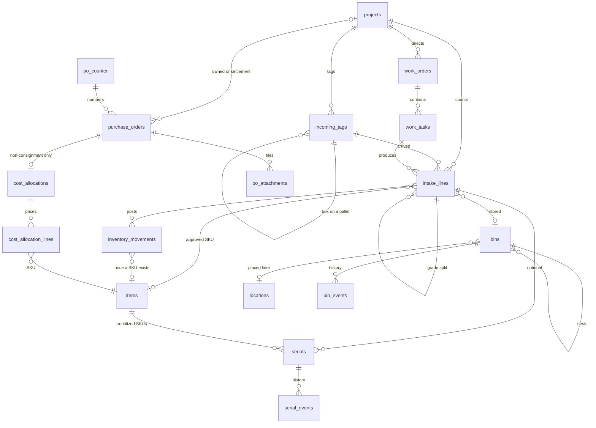
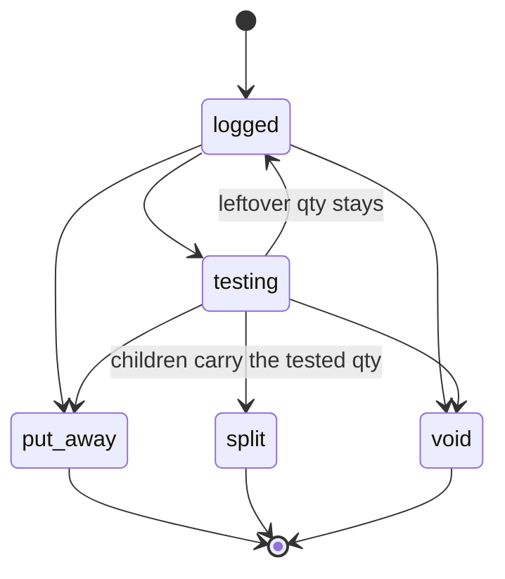
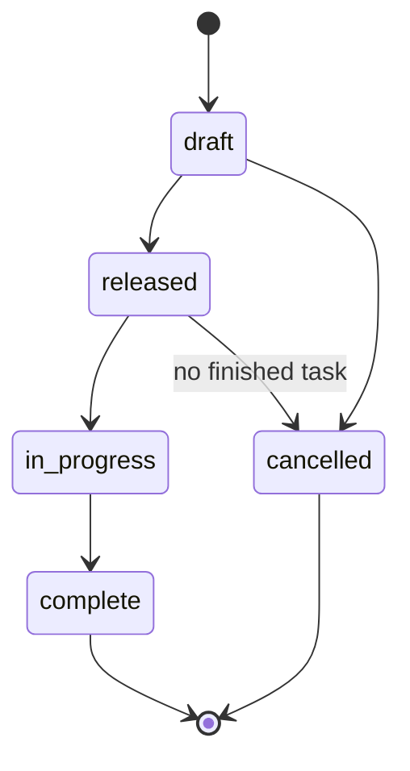
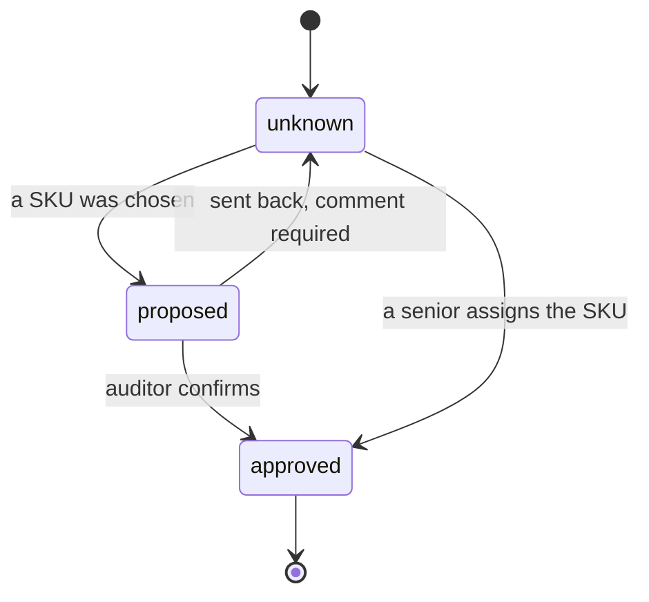
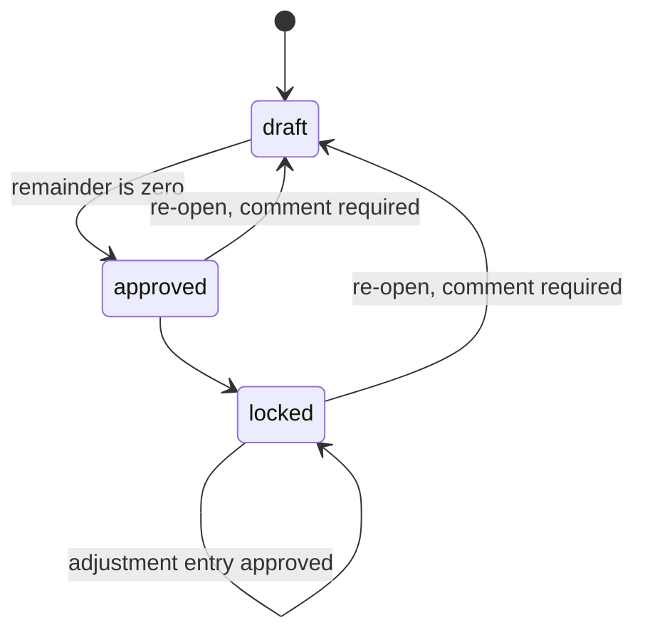

# Order to stock

Design only. Nothing in this note is built, and no migration is applied. Jan reviews it before any coding.

This is the inbound path from the truck to a bin of known SKUs. Purchase orders, the ledger, serials, and settlement math already sketched in `docs/purchase-orders.md` stay in force, except for cost. **Where that note prices a unit at intake or offers several automatic splits of a lot, this note wins:** COGS is assigned only for non-consignment work, only from the purchase-order total, and only on the final summary of received SKUs. A pricing officer types the unit prices. Consignment stays without a cost until a sale creates the consignor's purchase order.

Warehouse roles still see no money. New tables enable row level security and grant `service_role` only. The phone targets are Android Chrome and iOS Safari, with the scanner already described in `docs/mobile.md`.

## The seven situations

| | What arrives | What the floor does |
|---|---|---|
| 0 | A purchase order for a SKU that already exists | Receive the shipment and put it away. Rare. |
| 1 | A product that is not a SKU yet | Log what is printed on the part. Someone else creates the SKU. |
| 2 | Goods that need a test or a grade before the SKU is right | Test, then split the pile into the graded SKUs. |
| 3 | A server | Pull CPU, memory, SSD, HDD, and NIC/HBA cards into bins. |
| 4 | The chassis after that pull | Motherboard, heatsinks, PSUs, risers, and cables stay inside and still get identified. |
| 5 | Consignment on one or more projects (`AZSIM6930`, `OHNST6902`) | The same floor work as 1–4. Cost comes later, usually a purchase order to the consignor for a percent of the net sale. |
| 6 | Serial numbers | Usually captured on the SKUs that track them. Sometimes captured at intake, before the SKU is known. |

## What already exists

Items are one row per SKU. `items.quantity` is a cache. This design makes it the sum of ledger rows that already have a SKU. Bins are pallets, crates, and boxes (`20000-P`). They nest: a bin sits in another bin or at a location. `bin_events` stays the history. `current_location_id` is replaced by `parent_bin_id` and `location_id` as in `docs/purchase-orders.md`. The location list itself waits for Jan.

`po_counter` issues the next purchase-order number. `po_attachments` holds the vendor PDF (invoice, quote, order confirmation, or other) in the private `po-documents` bucket. A role without `can_view_financials` receives neither the file nor a signed URL.

Roles follow `docs/roles.md`. The clerk receives, moves bins, and adds photos, and does not see money and does not create a SKU. The senior who audits a SKU is the warehouse manager (`can_edit_items`). The pricing officer is new and is described under Cost.

Every live write stores `operator_id` from the session and `occurred_at` plus `created_at` from the server clock. The phone shows the person's initials, taken from their name at that moment and stored on the event so a later rename does not rewrite history. Each step has a comment box with no short length limit.

## What happens on the floor

A truck arrives. Each pallet and each loose box gets an incoming tag, for example `INCOMING AZSIM6903 P001`. The tag is a label, not a SKU and not a bin number.

A work order tells the team what to pull. Parts land in bins. The clerk's tag on the bin names the source, the server type, and the count. Pallet X with 12 Type 1 servers and 8 Type 2 servers gets two bins: `Pallet X - Type 1 Server - 12 units` and `Pallet X - Type 2 Server - 8 units`. Those words are the caption. The scannable identity is still the bin reference (`20014-B`).

An operator opens that bin and logs the header, then the lines. The header is the project, the incoming pallet, the server type, and the quantity from the clerk's tag. Each line is a product identifier, a quantity, and the bin that holds it. The operator may not know the SKU. A guessed SKU waits for audit. A senior can assign the SKU directly. If no SKU exists, someone with `can_edit_items` creates one.

Labels are one tap away on that screen: incoming tag, bin, item, and serial.

Some lines go to test. Probing and wiping happen there. Serials are captured on that bench when the SKU tracks them. The SKU can change from an untested identity to a graded one, and the bin can change with it. Fifty-one of item X in box B become 31 of grade A (SKU 1A in box B1) and 20 of grade B (SKU 1B in box B2).

The project ends as a list of SKUs, quantities, bins, and serials where the SKU has them. Each quantity can be walked back to the project, the incoming tag, the pallet, the server or bin it came out of, and the person who logged it.

The last physical step is put-away: the bin is placed at a warehouse or office location. That list is not in this note. Jan will send it. Until then a bin can be labeled and filled and has no fixed place.

## Domain model

A comment can hang on a project, tag, work order, task, intake line, serial, bin, or cost allocation. It is one table, not a line on the diagram.

### Projects

Same shape as `docs/purchase-orders.md`. A code such as `AZSIM6930` is the name the floor already uses. `type` is `consignment`, `owned_lot`, or `takeout`. `basis` is `consigned` or `owned`. Consignment is always consigned. An owned lot is always owned.

| Column | Notes |
|---|---|
| `id` | uuid |
| `code` | unique, `AZSIM6930` |
| `name` | text |
| `type` | `consignment`, `owned_lot`, or `takeout` |
| `basis` | `consigned` or `owned` |
| `vendor_id` | consignor or seller |
| `physical_status` | `received`, `processing`, `processed` |
| `financial_status` | `open`, `cost_pending`, `costed`, `settling`, `settled` |
| `status` | `active` or `closed` |
| `model` | `revenue_share` or `negotiated` on consignment. Empty when owned |
| `consignor_share_percent` | revenue share only. Money. Hidden from the floor |
| `settlement_cadence` | `per_sale`, `periodic`, or `negotiated_batch` |
| `notes` | text |
| `operator_id`, `operator_initials`, `occurred_at`, `created_at` | session, initials snapshot, server clock |

Warehouse screens show the code, the type, the consignor's name, and counts. Share percent and every dollar stay off those payloads.

### Purchase orders and the counter

The purchase order tables already exist. This flow uses them as they are.

`po_counter` is one row. It hands out the next number. Settlement purchase orders for consignors use that same counter when finance creates them. The floor never sees the counter.

`po_attachments` is the file on the order: `vendor_invoice`, `quote`, `order_confirmation`, or `other`. Bytes live in `po-documents`. Signed URLs exist only for `can_view_financials`.

Columns this flow reads from `purchase_orders`: `id`, `number`, `vendor_id`, `project_id`, `purpose` (`purchase`, `settlement`, `buyout`), `status`, `currency`, `freight_in`, and the order total finance already sees (line extensions plus freight-in). Line prices on the purchase order are the vendor's prices. They are not COGS until a pricing officer allocates the total. See Cost.

### Incoming tags

The paper on the pallet or the box before anyone knows the SKUs.

| Column | Notes |
|---|---|
| `id` | uuid |
| `project_id` | required |
| `purchase_order_id` | set when the truck is a known purchase order with no project |
| `kind` | `pallet` or `box` |
| `sequence` | `P001`, `B002`, unique inside the project |
| `label` | the words printed, `INCOMING AZSIM6903 P001` |
| `code` | the barcode, `IN-AZSIM6903-P001`, unique |
| `parent_tag_id` | a box tag can name its pallet tag |
| `bin_id` | set when this physical object is also a bin, or when the goods have moved into one |
| `notes` | text |
| `operator_id`, `operator_initials`, `occurred_at`, `created_at` | as everywhere |

### Work orders and tasks

A work order is the instruction. Tasks are the pulls.

| Column | Notes |
|---|---|
| `id` | uuid |
| `project_id` | required |
| `incoming_tag_id` | the pallet or box the work starts from |
| `title` | `Pull Pallet X` |
| `state` | see the work-order states |
| `instructions` | text, the long comment to the crew |
| `operator_id`, `operator_initials`, `occurred_at`, `created_at` | who released it |

`work_tasks`:

| Column | Notes |
|---|---|
| `id` | uuid |
| `work_order_id` | required |
| `server_type` | `Type 1`, `Type 2`, free text until a catalog exists |
| `server_qty` | the count on the clerk's tag, 12 or 8 |
| `bin_id` | the bin that receives the pull |
| `instructions` | text |
| `state` | `open`, `done`, or `cancelled` |
| `operator_id`, `operator_initials`, `occurred_at`, `created_at` | who finished the task |

### Intake lines

One line is one product pile: an identifier, a quantity, a bin, and eventually a SKU.

| Column | Notes |
|---|---|
| `id` | uuid |
| `project_id` | set on project work. Empty on a plain purchase-order receipt |
| `purchase_order_id`, `po_line_id` | set when the goods belong to a purchase order |
| `incoming_tag_id` | the pallet or box tag |
| `work_task_id` | set when a pull produced the line |
| `parent_line_id` | the line this one was split from. Empty on the first count |
| `source_bin_id` | the server bin or chassis the part came out of |
| `line_kind` | `whole`, `pulled`, or `remains` |
| `identifier` | what the operator typed or scanned: part, model, or a description |
| `qty` | greater than 0 |
| `bin_id` | where this pile sits |
| `item_id` | empty until the SKU is approved |
| `proposed_item_id` | the guess waiting for audit |
| `sku_state` | `unknown`, `proposed`, or `approved` |
| `line_state` | `logged`, `testing`, `split`, `put_away`, or `void` |
| `grade` | text, when grading has happened |
| `notes` | text |
| `operator_id`, `operator_initials`, `occurred_at`, `created_at` | who logged it |

`line_kind = remains` is a part that stays in the chassis. It still needs a SKU. It is not a second pull into a parts bin.

A known purchase-order line starts with `sku_state = approved` and `item_id` already set. The identifier is the SKU.

### SKU audit

The audit is the line's `sku_state`, plus one event row per change.

| Column | Notes |
|---|---|
| `id` | uuid |
| `intake_line_id` | required |
| `from_state`, `to_state` | `unknown`, `proposed`, `approved` |
| `item_id` | the SKU this event names |
| `comment` | text. Required when an audit is sent back |
| `operator_id`, `operator_initials`, `occurred_at`, `created_at` | the auditor or the senior |

A clerk may set `proposed`. Only `can_edit_items` may approve, assign, or create the item. Creating an item uses the existing save, which assigns the SKU number. The clerk cannot open that form.

### Grade operations

The 51-to-31/20 split is one operation. The parent line moves to `split`. Each result is a new intake line with `parent_line_id` pointing at the parent.

| Column | Notes |
|---|---|
| `id` | uuid |
| `parent_line_id` | the pile that was tested |
| `qty_in` | how many were tested, 51 |
| `comment` | text |
| `operator_id`, `operator_initials`, `occurred_at`, `created_at` | the bench |

Child lines store the new SKU, the new bin, the grade, and the quantity. Their quantities add up to `qty_in`. A remainder that was not tested stays on the parent, and the parent stays `logged` or `testing` for that leftover quantity. The tested portion is the parent of the children.

### Serials

Same shape as `docs/purchase-orders.md`. `taxonomies.serialized` defaults false. `items.serialized` empty means "use the taxonomy." A serial may exist before the SKU: `item_id` is empty and the serial points at the intake line.

| Column | Notes |
|---|---|
| `id` | uuid |
| `serial` | trimmed, unique among rows still `in_stock` |
| `item_id` | empty until the SKU is approved |
| `intake_line_id` | the pile it was captured on |
| `project_id` | copied from the line |
| `ownership` | `owned` or `consigned` |
| `status` | `in_stock`, `sold`, `rma_returned`, `returned_to_vendor` |
| `stock_status` | `available`, `damaged`, `quarantine`, `hold` |
| `operator_id`, `operator_initials`, `occurred_at`, `created_at` | who captured it |

`serial_events`: `serial_id`, the new status, `movement_id` when a ledger row exists, `ref_type`, `ref_id`, `ref_label`, `operator_id`, `operator_initials`, `occurred_at`, `created_at`.

### Bins and locations

Keep `bins` and `bin_events`. Add the nesting columns from `docs/purchase-orders.md`.

`bins` keeps `number`, `type` (`P`, `C`, `B`), `reference`, `notes`, `printed_count`, `last_printed_at`, `created_at`, `created_by`. Add `parent_bin_id`, `location_id`, and a check that at most one of those is set. `notes` holds the clerk's caption (`Pallet X - Type 1 Server - 12 units`) so a reprint can show it.

`locations`: `id`, unique `code`, `description`. No rows until Jan's list arrives.

`bin_events` keeps `created`, `printed`, `reprinted`, and `moved`. A move gains `operator_id`, `operator_initials`, `occurred_at`, `from_parent_bin_id`, and `to_parent_bin_id`.

### Ledger

`inventory_movements` is the only quantity log. `items.quantity` is rewritten, in the same transaction, to the sum of movements that have an `item_id`. Quantity with no SKU stays on the movement and on the project, and stays out of `items.quantity`.

| Column | Notes |
|---|---|
| `id` | uuid |
| `item_id` | empty while the SKU is unknown |
| `project_id` | set for project goods, and kept after a settlement purchase order exists |
| `intake_line_id` | the pile |
| `bin_id` | empty only while a known receipt has not been put in a bin |
| `direction` | `in` or `out` |
| `qty` | greater than 0 |
| `ownership` | `owned` or `consigned` |
| `stock_status` | `available`, `damaged`, `quarantine`, `hold` |
| `transfer_id` | shared by the two rows of a bin-to-bin move or a status change |
| `ref_type` | `purchase_receipt`, `project`, `putaway`, `grade_split`, `status_change` |
| `ref_id`, `ref_label` | the purchase order, project, or tag |
| `source_movement_id` | the layer an `out` consumed |
| `operator_id`, `operator_initials`, `occurred_at`, `created_at` | server |
| `notes` | text |

Putting a quantity into a different bin is an `out` and an `in` with one `transfer_id`. Moving the bin itself, later, is only a `bin_events` row. The product rows keep their `bin_id`.

A grade split posts an `out` of the parent and an `in` of each child. When the parent had a SKU, that SKU's quantity falls and the children's SKUs rise. There is no second receipt.

Cost is not a column on this table.

### Comments

| Column | Notes |
|---|---|
| `id` | uuid |
| `entity_type` | `project`, `incoming_tag`, `work_order`, `work_task`, `intake_line`, `serial`, `bin`, `cost_allocation` |
| `entity_id` | uuid of that row |
| `body` | text, no short limit |
| `operator_id`, `operator_initials`, `occurred_at`, `created_at` | who wrote it |

### Cost allocations

One allocation prices one non-consignment purchase order. It prices the final summary, which is SKU and quantity after every split. It does not price intake lines.

| Column | Notes |
|---|---|
| `id` | uuid |
| `purchase_order_id` | required. Consignment orders are refused |
| `project_id` | copied when the order has a project |
| `state` | `draft`, `approved`, or `locked` |
| `po_total` | the order total snapshotted when the row is approved |
| `remainder` | `po_total` minus the sum of line extensions. Zero is the only value that can be approved |
| `summary_changed_at` | set when a grade split or a correction changes the received list after approval |
| `operator_id`, `operator_initials`, `occurred_at`, `created_at` | the pricing officer |
| `notes` | text. Required on re-open and on an adjustment |

`cost_allocation_lines`:

| Column | Notes |
|---|---|
| `id` | uuid |
| `allocation_id` | required |
| `item_id` | the received SKU. Required |
| `qty` | the final quantity of that SKU for this purchase order |
| `unit_price` | numeric(12,4), zero or greater. What the officer typed |
| `extension` | numeric(12,2). The dollars posted for the line |
| `rounding_note` | required when the extension is not the cent rounding of price times quantity |
| `source` | `summary` or `adjustment` |
| `supersedes_line_id` | the earlier line this one replaces |
| `operator_id`, `operator_initials`, `occurred_at`, `created_at` | who priced it |

Approving posts buy transactions for those extensions (`source = po`). It does not post another inventory `in`. Warehouse payloads omit the allocation, the buy, and the remainder.

## Walkthroughs

### 0. A purchase order for a known SKU

A purchase order already lists the SKU and the quantity. The clerk scans the PO, confirms the count, scans a bin, and prints the bin label if the bin is new. The line is born approved. The ledger `in` uses that SKU. `items.quantity` updates. No project is required.

The pricing officer later opens the final summary, which is that SKU and the quantity actually received. They type a unit price. The extension has to use up the purchase-order total. The vendor's line price can be copied in as a starting guess. It becomes COGS only when the allocation is approved.

### 1. The product is not a SKU yet

The operator scans the incoming tag, types the part number from the label, enters the quantity, and scans the bin. `sku_state` stays `unknown`. The quantity is on the ledger with an empty `item_id`, so the items list does not grow.

Search suggestions use the same part, OEM, and model matches as Lens. The screen lists them and does not pick one. A person who recognizes a SKU sets it to `proposed`. A warehouse manager approves it, or assigns a different one, which is already `approved`. If none of the suggestions is right, that manager creates the item. The SKU number is assigned on save, as it is today. One transaction then writes `item_id` onto the line, its serials, and its ledger rows, and refreshes `items.quantity`. There is no second `in`.

### 2. Test and grade, including 51 to 31 and 20

Item X, still untested, sits in box B, quantity 51. The bench scans box B, records a test comment, and captures serials for the pieces that have them.

The result is one grade operation. Thirty-one move to SKU 1A in box B1. Twenty move to SKU 1B in box B2. The parent line becomes `split`. Each child stores `parent_line_id`, the new bin, the grade, and the operator. The ledger takes 51 out of item X and puts 31 and 20 in. Box B's balance for item X is zero. Serials that were on the parent follow the child they were graded into, and `serial_events` records the move.

If the SKUs 1A and 1B are new, they are created and audited before the split is posted. If they already exist, the senior's choice on the bench is the approval.

### 3. Pulling a server apart

Pallet X is tag `INCOMING AZSIM6903 P001` and holds 12 Type 1 servers and 8 Type 2 servers. The work order `Pull Pallet X` has two tasks. Each task prints a bin label whose caption is `Pallet X - Type 1 Server - 12 units` or `Pallet X - Type 2 Server - 8 units`.

The operator scans the pallet tag, confirms the server type and the 12, then adds lines: a CPU identifier and a quantity, memory, SSDs, HDDs, NIC and HBA cards. Each line has its own bin, which may be the task bin or a smaller box inside it. `line_kind` is `pulled`. `source_bin_id` is the server's bin when the chassis itself has one. Identifiers that are not SKUs follow situation 1.

### 4. What stays in the chassis

After the pull, the chassis still holds the motherboard, heatsinks, PSUs, risers, and cables. Those are intake lines with `line_kind = remains`, the same parent server, and the chassis bin. They go through the same unknown, proposed, and approved SKU path. They do not have to move to a parts bin to be identified. A comment on the chassis says what was left in it.

### 5. Consignment

`AZSIM6930` and `OHNST6902` are projects with `basis = consigned`. Situations 1 through 4 are unchanged. The ledger rows are `consigned`. No cost allocation can be created. The pricing officer's list does not offer these projects.

When a unit sells, finance generates a purchase order to the consignor, usually for that project's share of the net sale. The order uses `po_counter`, `purpose = settlement`, and stays a draft until someone with `can_edit_financials` approves it. That approval is the moment the unit gets a cost. The floor never sees the percent, the net, or the purchase order. The detailed share and deduction rules stay in `docs/purchase-orders.md`.

### 6. Serials at SKU level, and sometimes at intake

A SKU whose taxonomy is serialized, or whose own flag says so, needs a serial for each piece before put-away. The bench is the usual place, because that is when the drive or the board is in hand. The serial screen is the one already used for serial labels: scan or type, Enter adds, duplicates are ignored.

Some piles are serialized before anyone knows the SKU. The operator adds the serial on the intake line. `item_id` is empty. When the SKU is approved, the same serial row gains `item_id`. A second in-stock copy of the same serial is refused anywhere in the company.

## State machines

### Intake line

`split` and `void` stop that line. Children of a split start again at `logged`. Put-away means the sellable bin is set and, when the SKU is serialized, the serials are present. A line can sit in a holding bin from the moment it is logged.

### Work order

A task is `open`, then `done` or `cancelled`. The order becomes `in_progress` when the first task is done, and `complete` when every task is done or cancelled and at least one is done.

### SKU approval

A grade split does not move an approved parent backwards. The children have their own SKU state. A senior's assign lands on `approved` without a second person.

### Cost allocation

Approve and lock can be one action. A locked row stays locked while an adjustment is added beside it.

## Lineage

Every intake line stores the incoming tag, the project, the work task, the source bin, and the parent line. Those four links are the origin.

From any bin quantity or any serial, the walk is:

1. The ledger row or the serial points at an intake line.
2. That line's `parent_line_id` chain ends at the first count, which still has the incoming tag and the project.
3. The tag names the pallet. A box tag names its pallet tag.
4. `source_bin_id` and the work task name the server type and the chassis the part came out of.
5. Each line, tag, task, serial event, and comment has the operator's initials and the server time.

The project screen lists SKU, quantity, bin, and serials, and each row opens this walk. A quantity that has been split shows the children, and each child shows the parent pile and the grade operation. Nothing in the walk is deleted when a line is split or voided. Void keeps the row and the events.

Moving a bin to a location does not break the walk. The product still points at the bin. The bin points at the location.

## Cost

### Who gets a cost, and when

COGS is assigned only for non-consignment projects and non-consignment purchase orders.

Consignment stays cost-pending from intake through put-away. The sale-based purchase order to the consignor is the cost. That order is not this allocation.

For everything else, COGS is the purchase-order total, spread across the **final summary** of received SKUs and quantities. The summary is one row per SKU: the quantity still received against that purchase order after grade splits. Two bins of the same SKU are one row. Intake lines are not cost lines. A parent that was fully split is not on the summary. Its children are.

The pricing officer types a unit price on each summary row. The screen may start those prices from the vendor's line prices when the SKU matches. The officer's prices are the ones that post.

### Draft, approved, locked

| State | What is true |
|---|---|
| `draft` | The officer is entering prices. The remainder may be anything. No COGS is posted. |
| `approved` | The remainder is zero and the buy transactions are posted. The previous approved snapshot remains the cost of record if someone re-opens, until a new draft is approved. |
| `locked` | The approved figures are frozen. A later change is a re-open or an adjustment entry. |

The officer can save a draft as often as they like. Approve is refused while the check below fails. Lock is available only from approved. **Approve and lock** does both when the summary is finished.

### The check, rounding, and the remainder

Each line stores a unit price with four decimal places and an extension in cents. The extension starts as the unit price times the quantity, rounded half-up to the cent.

The remainder is the purchase-order total minus the sum of the extensions. Approve is allowed only when the remainder is `0.00`.

A leftover cent is the officer's to place. They change one line's extension and fill in `rounding_note`. The unit price they typed stays. The extension is what posts. The screen shows the remainder in cents and names the line that absorbed it. The system does not sprinkle pennies by itself.

Example. The purchase-order total is `$1,000.00`. The summary is 3 of SKU A and 1 of SKU B. The officer enters A at `$250.00` (extension `$750.00`) and B at `$249.99` (extension `$249.99`). The remainder is `$0.01`, so Approve stays off. The officer sets B's extension to `$250.00` and notes `rounding`. The remainder is `$0.00`. Approve posts `$750.00` and `$250.00`.

Zero is allowed, so a scrap SKU can sit on the summary at a zero price while the other rows absorb the total. A negative price is refused. Quantities on the summary are greater than zero.

The `po_total` stored on the allocation is copied from the purchase order at approve time. A later edit to the purchase order's total sets `summary_changed_at` and blocks a new use of the old approval until the officer re-opens.

### A grade split or a correction after costing

Quantity moves when the floor posts the split. Dollars do not move by themselves.

The allocation is marked `summary_changed_at`. The children have no cost. The parent's posted amount is held as unassigned dollars on that allocation, visible on the pricing screen only, so a SKU with nothing left in the bin is not still carrying COGS.

Two ways to finish:

- **Re-open** returns the allocation to `draft` and requires a comment. The summary is rebuilt from the received SKUs as they are now. Prices copy onto SKUs that are still there. New SKUs start blank. The previous buys stay in force until the new draft is approved. Approval reverses those buys and posts the new extensions. The new sum still has to equal the same purchase-order total.
- **Adjustment entry**, used when the allocation is locked and the officer is moving dollars without rebuilding the whole summary. New lines with `source = adjustment` take the parent's extension down and put extensions on the children. The adjustment has its own draft and its own approve check: original extensions plus adjustments still equal the purchase-order total. The locked summary lines stay as history. A comment is required.

A wrong price, with the SKU list unchanged, uses the same two paths. Re-open when the officer will retype the summary. An adjustment when they are posting a delta under the lock.

### Who can see it

`can_view_financials` is required to read unit prices, extensions, the remainder, the purchase-order total, freight, attachments, and buy transactions. The clerk and the warehouse manager do not have that capability. Their intake, work order, test, and put-away payloads omit those fields on the server. Hiding a column in the browser is not the control.

The pricing officer, admin, and staff have `can_view_financials`. Writing an allocation uses a new capability, `can_allocate_cogs`, held by the pricing officer and by admin and staff. The officer does not receive trucks and does not send purchase orders.

### The pricing officer's screen

The screen lives on Pricing, which is still a placeholder. It is a desk screen. The phone flows do not gain a cost field.

The list shows non-consignment purchase orders that have a received summary: number, vendor, project code when there is one, order total, summary status (ready, or changed since approval), allocation state, and the remainder. Consignment projects are absent. Opening one shows the final summary: SKU, name, quantity, unit price, extension, and the remainder against the purchase-order total. Bins and serials are a disclosure under the row so the officer can see where the quantity sits. They are not part of the math.

**Save draft** stores the prices. **Approve** runs the check. **Lock** freezes an approved allocation. **Approve and lock** is the normal end. **Re-open** and **New adjustment** ask for a comment, then land on a draft the officer can edit. A changed summary shows a banner that the received list no longer matches the approved lines.

## Screens, in the order the floor uses them

Each screen is a phone page first. One primary action. Scan fills the field the cursor is in. A handheld scanner that types and sends Enter uses that same field. Print is on the screen that created the thing, not a trip to another desk.

| Screen | Fewest steps | Labels from here |
|---|---|---|
| Arrive | Pick or scan the project. Enter how many pallets and boxes. Print. | Incoming tag |
| Work order | Scan the incoming tag. Add a task per server type and quantity. Print a bin for each task. | Bin, with the clerk's caption |
| Bin log | Scan the tag, confirm type and quantity, scan the destination bin, add identifier and quantity. Repeat. | Bin, item |
| SKU queue | Senior sees proposed lines. Approve, assign, or create. | Item, after approval |
| Test bench | Scan the source bin. Enter the split. Scan serials. Scan the new bins. | Bin, item, serial |
| Project | SKU, quantity, bin, serials. Open a row for the lineage. | Any of the four |
| Put-away | Scan the bin, scan the location. Waits on the location list. | Bin reprint |

The item label and the serial label are the ones already specified in `docs/labels.md`. The bin label is the one in `docs/bin-labels.md`, plus the caption line when it is printed from a work order. The incoming tag is new: the same 90 mm × 29 mm roll as the bin label, a Code 128 of `IN-AZSIM6903-P001`, and one line of words, `INCOMING AZSIM6903 P001`.

Creating a SKU and the pricing screen are desk work. The queue and the allocation list can be opened on a phone to read. The clerk's phone does not offer Create SKU, and no phone in the warehouse offers a price.

## Phased build

Each phase is a small pull request. Phase 1 is the smallest slice that puts a known SKU into a bin and proves the ledger. Later phases do not reshape that ledger. Cost waits until a final summary exists, and it never appears on a warehouse payload.

1. **Known SKU into a bin.** Receive a purchase-order line that already has a SKU, scan a bin, post the ledger `in`, refresh `items.quantity`. Scenario 0, quantities only. No cost screen.
2. **Pricing officer, for a finished non-consignment purchase order.** Final summary, draft, the remainder check, approve, lock. Scenario 0 can be costed as soon as the receipt is marked final. Consignment is refused.
3. **Incoming tags and the bin log.** Projects, tags, unidentified lines, comments, initials, and the four labels. Quantity with no SKU stays out of `items.quantity`.
4. **SKU audit.** Propose, send back, senior assign, create the missing item, write `item_id` onto the existing ledger rows.
5. **Work orders and the pull.** Tasks, server-type bins, pulled lines, remains-in-chassis lines, lineage back to the pallet.
6. **Test, grade, serials.** The 51-to-31/20 split, serials at intake and at the bench, lineage on the children.
7. **Put-away to a place.** After the location list is loaded. Nest a bin in a bin or a location. One `bin_events` row. No new inventory rows per unit.
8. **Re-open and adjustments.** Required once grade splits can happen after phase 2 has posted COGS. The unassigned-dollar hold and both repair paths.
9. **Consignment purchase order at sale.** Still cost-pending until then. Depends on sales existing. The share math stays the settlement design in `docs/purchase-orders.md`.

## Open questions

1. Is the purchase-order total that COGS must tie to the grand total (merchandise plus freight-in), or the merchandise subtotal only? Do other landed costs join that figure, stay out, or wait for a later pool?
2. May a pricing officer approve an allocation when the purchase order is only partly received, or only after the receipt is marked complete?
3. When a project has several non-consignment purchase orders, is each order allocated onto the SKUs that trace to it, or is one pool of those totals allocated across the whole project summary?
4. Is the pricing officer a new role with `can_allocate_cogs` and `can_view_financials`, and should Approve and Lock be the same person?
5. After a locked allocation, which path is the default when a grade split changes the summary: re-open the whole summary, or an adjustment entry that leaves the lock in place?
6. Incoming tags: stay on the 90 mm × 29 mm bin roll, or move to the 62 mm × 100 mm roll when the words need more room?
7. Confirm the bin barcode stays the reference (`20014-B`) and the clerk's words (`Pallet X - Type 1 Server - 12 units`) are a caption on that same label.
8. Confirm the SKU auditor is the warehouse manager already proposed in `docs/roles.md`, rather than a separate auditor title.
9. A failed proposal: send the line back to `unknown` with a comment, or leave it `proposed` for a second guess?
10. For a server, is the chassis itself a bin, a single intake line, or both?
11. Parts that stay in the chassis: one line per part type, or one line for the shell until someone identifies the pieces?
12. Which taxonomies require a serial before put-away, and which intakes must capture a serial even when the taxonomy does not?
13. A test that covers only part of a pile: confirm the untested remainder stays on the parent SKU and in the parent bin.
14. Put-away to a fixed location waits on the locator list. Confirm phase 7 does not invent location codes.
